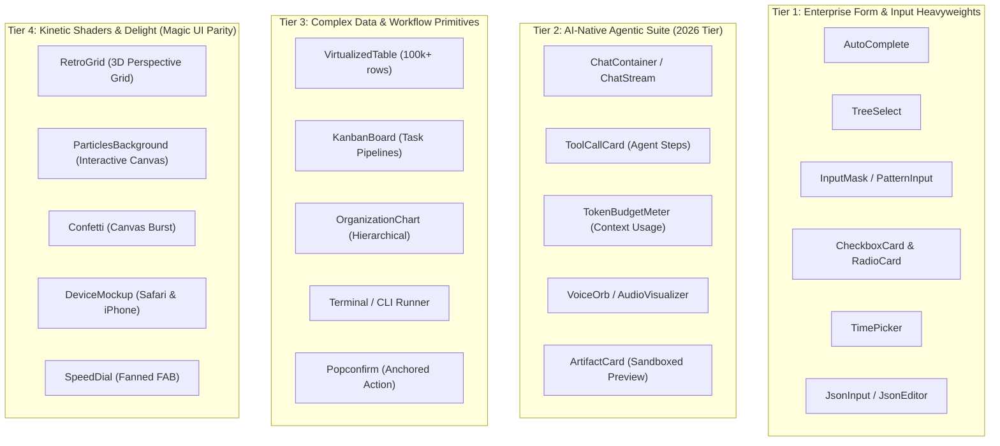

# Comprehensive Deep Research: Top 10 Global UI Component Ecosystems & DesignKit Expansion Roadmap

> **Author**: Antigravity Deep Research Agent  
> **Date**: November 2026  
> **Scope**: Primary-source architectural census of the top 10 UI component libraries, cross-catalog matrix, and strategic expansion recommendations for DesignKit (React 19 + Vue 3 / Nuxt 4).

---

## Executive Summary

Modern web application development has converged around modular, headless, and accessible design system architectures. While early component suites bundled heavy runtime styles and prescriptive component hierarchies, the 2025–2026 landscape is defined by **code ownership** (the shadcn model), **WAI-ARIA primitive foundations** (Radix, Base UI, Zag.js, Reka UI), **hybrid enterprise data systems** (virtualization, nested hierarchical structures), and **AI-native primitives** (conversational streams, reasoning blocks, tool execution cards).

This research conducts an exhaustive census of the **top 10 UI component libraries globally**, catalogs their exact component inventories from primary documentation, benchmarks them against **DesignKit's current 127 components**, and defines an actionable blueprint to elevate DesignKit into the definitive full-stack component system for modern SaaS, enterprise software, and AI applications.

---

## Part 1: Census of the Top 10 Global UI Component Ecosystems

Below is the verified, primary-source component breakdown of each benchmark ecosystem.

### 1. shadcn/ui (Radix UI + Tailwind CSS)
* **Architecture**: Copy-and-paste CLI distribution, headless Radix UI / Base UI foundation, Tailwind CSS styling, React 19 native.
* **Component Count**: ~48 core components + 24 AI Elements + 80+ official blocks (~72 total primitive entries).
* **Primary Source**: [ui.shadcn.com/docs/components](https://ui.shadcn.com/docs/components) & [ui.shadcn.com/docs/ai](https://ui.shadcn.com/)
* **Full Inventory**:
  * *Layout & Structure*: Aspect Ratio, Card, Collapsible, Resizable, Scroll Area, Separator, Sidebar.
  * *Navigation*: Breadcrumb, Menubar, Navigation Menu, Pagination, Tabs.
  * *Inputs & Forms*: Button, Checkbox, Form, Input, Input OTP, Label, Radio Group, Select, Slider, Switch, Textarea, Toggle, Toggle Group, Combobox, Date Picker.
  * *Data Display*: Avatar, Badge, Calendar, Carousel, Chart (Recharts), Data Table (TanStack Table), Table, Tooltip.
  * *Feedback & Overlays*: Alert, Alert Dialog, Context Menu, Dialog, Drawer, Dropdown Menu, Hover Card, Popover, Progress, Skeleton, Sonner, Toast.
  * *AI Elements*: Chain of Thought, Chat, Checkpoint, Confirmation, Context, File Tree, Inline Citation, Message, Model Selector, Plan, Prompt Input, Queue, Reasoning, Sources, Stack Trace, Subagent, Suggestion, Task, Terminal, Test Results, Tool, Trace.

### 2. Ant Design (AntD v5 & Ant Design X)
* **Architecture**: Comprehensive enterprise design system, CSS-in-JS (Emotion-based derivative with zero-runtime option), React 18/19.
* **Component Count**: 68 core components + 16 AI components (`@ant-design/x`) = 84+ total components.
* **Primary Source**: [ant.design/components/overview](https://ant.design/components/overview) & [x.ant.design/components/overview](https://x.ant.design/components/overview)
* **Full Inventory**:
  * *General*: Button, FloatButton, Icon, Typography.
  * *Layout*: Divider, Flex, Grid, Layout (Header, Sider, Content, Footer), Space, Splitter.
  * *Navigation*: Anchor, Breadcrumb, Dropdown, Menu, Pagination, Steps, Tabs.
  * *Data Entry*: AutoComplete, Cascader, Checkbox, ColorPicker, DatePicker, Form, Input, InputNumber, Mentions, Radio, Rate, Select, Slider, Switch, TimePicker, Transfer, TreeSelect, Upload.
  * *Data Display*: Avatar, Badge, Calendar, Card, Carousel, Collapse, Descriptions, Empty, Image, List, Popover, QRCode, Segmented, Statistic, Table, Tag, Timeline, Tooltip, Tour, Tree.
  * *Feedback*: Alert, Drawer, Message, Modal, Notification, Popconfirm, Progress, Result, Skeleton, Spin, Watermark.
  * *Ant Design X (AI Suite)*: Bubble (chat bubble), Conversations (session manager), Confirmation (execution approval), Think / ThoughtChain (reasoning log), Welcome (assistant hero), Prompts (suggestion chips), Sender (multimodal input), Actions (feedback toolbar), CodeHighlighter, FileCard, FolderFile Tree, Mermaid, Sources.

### 3. Mantine (v7)
* **Architecture**: Modular CSS Modules, vanilla CSS custom properties, polymorphic `component` prop, TypeScript-first.
* **Component Count**: 100+ core components + 60+ hooks + specialized packages (Mantine Form, Dates, Charts, CodeHighlight, Dropzone, Spotlight).
* **Primary Source**: [mantine.dev/core/get-started](https://mantine.dev/core/get-started/)
* **Full Inventory**:
  * *Inputs & Controls*: Autocomplete, Checkbox, Chip, ColorPicker, ColorSwatch, FileButton, FileInput, JsonInput, MultiSelect, NativeSelect, NumberInput, PasswordInput, PinInput, Radio, Rating, SegmentedControl, Select, Slider, RangeSlider, Switch, Textarea, TextInput.
  * *Navigation*: Anchor, Breadcrumbs, Burger, NavLink, Pagination, Tabs.
  * *Feedback & Overlays*: Alert, Badge, Loader, Progress, RingProgress, Skeleton, Tooltip, Dialog, Drawer, HoverCard, Menu, Modal, Popover, Tooltip.
  * *Layout & Containers*: AppShell, AspectRatio, Center, Container, Flex, Grid, SimpleGrid, Group, Space, Stack.
  * *Data Display & Typography*: Blockquote, Code, CodeHighlight, DataList, Image, Kbd, List, Mark, Table, Text, Title, Avatar, BackgroundImage, Box, Button, ActionIcon, Collapse, Divider, FocusTrap, Indicator, Paper, Portal, ScrollArea, ThemeIcon, Timeline, VisuallyHidden.

### 4. MUI (Material UI v5/v6 + MUI X)
* **Architecture**: Google Material Design (M2/M3) & Joy UI, Emotion/styled-engine, enterprise data grids.
* **Component Count**: ~62 core components + 8 MUI X enterprise components = ~70 total components.
* **Primary Source**: [mui.com/material-ui/all-components](https://mui.com/material-ui/all-components/)
* **Full Inventory**:
  * *Inputs*: Autocomplete, Button, Button Group, Checkbox, Floating Action Button (FAB), Number Field, Radio Group, Rating, Select, Slider, Switch, Text Field, Transfer List, Toggle Button.
  * *Data Display*: Avatar, Badge, Chip, Divider, Icons, List, Table, Tooltip, Typography.
  * *Feedback*: Alert, Backdrop, Dialog, Progress (Linear & Circular), Skeleton, Snackbar.
  * *Surfaces*: Accordion, App Bar, Card, Paper.
  * *Navigation*: Bottom Navigation, Breadcrumbs, Drawer, Link, Menu, Menubar, Pagination, Speed Dial, Stepper, Tabs.
  * *Layout*: Box, Container, Grid, Stack, Image List.
  * *Lab & MUI X*: Data Grid (virtualized), Date and Time Pickers, Charts, Tree View, Masonry, Timeline.

### 5. Chakra UI (v3) / Ark UI
* **Architecture**: Headless Ark UI primitives powered by Zag.js finite state machines, zero-runtime Panda CSS / Emotion engine.
* **Component Count**: ~70 core components.
* **Primary Source**: [chakra-ui.com/docs/components](https://chakra-ui.com/docs/components)
* **Full Inventory**:
  * *Layout*: Aspect Ratio, Bleed, Box, Center, Container, Flex, Float, Grid, Group, Scroll Area, Separator, SimpleGrid, Splitter, Stack, Wrap.
  * *Typography*: Blockquote, Code, Code Block, Heading, Highlight, Kbd, Link, Link Overlay, List, Mark, Prose, Rich Text Editor, Text.
  * *Buttons*: Button, Close Button, Icon Button, Download Trigger.
  * *Forms*: Checkbox, Checkbox Card, Color Picker, Date Picker / Calendar, Editable, Field, File Upload, Input, Number Input, Pin Input, Radio / Radio Card, Range Slider, Rating, Select / Listbox, Signature Pad, Slider, Switch, Tags Input, Textarea.
  * *Data Display*: Avatar, Badge, Card, Clipboard, Data List, Empty State, Icon, Image, Marquee, QR Code, Stat, Table, Tag, Timeline.
  * *Feedback*: Alert, Progress / Progress Circle, Skeleton, Spinner, Status, Toast.
  * *Overlays*: Action Bar, Dialog, Drawer, Floating Panel, Hover Card, Menu, Popover, Tooltip, Toggle Tip.
  * *Disclosure & Navigation*: Accordion, Breadcrumb, Carousel, Collapsible, Pagination, Steps, Tabs, Skip Nav.

### 6. HeroUI (formerly NextUI v2)
* **Architecture**: Tailwind CSS + React Aria headless primitives, spring animations with Framer Motion, Next.js optimization.
* **Component Count**: ~48 components.
* **Primary Source**: [heroui.com/docs/components](https://heroui.com/docs/components)
* **Full Inventory**:
  * Accordion, Autocomplete, Alert, Avatar, Badge, Breadcrumbs, Button, ButtonGroup, Calendar, Card, Checkbox, Checkbox Group, Chip, Circular Progress, Code, Date Input, Date Picker, Date Range Picker, Divider, Dropdown, Drawer, Form, Image, Input, Input OTP, Kbd, Link, Listbox, Modal, Navbar, Number Input, Pagination, Popover, Progress, Radio Group, Range Calendar, Scroll Shadow, Select, Skeleton, Slider, Snippet, Spacer, Spinner, Switch, Table, Tabs, Toast, Textarea, Time Input, Tooltip, User.

### 7. Tremor (v3 & Tremor Raw)
* **Architecture**: Specialized Tailwind CSS + Radix UI component system for SaaS metrics, dashboards, and financial analytics.
* **Component Count**: ~35 components.
* **Primary Source**: [tremor.so/docs/components](https://tremor.so/docs/components)
* **Full Inventory**:
  * *Visualizations*: Area Chart, Bar Chart, Line Chart, Scatter Chart, Donut Chart, Funnel Chart, SparkArea, SparkBar, SparkLine, BarList, Data Bars, Progress Circle, Tracker.
  * *UI & Feedback*: Accordion, Badge, Button, Callout, Card, Dialog, Divider, Icons, Legend, List, Table (TableHead, TableRow, TableCell), Tabs.
  * *Inputs & Forms*: Date Range Picker, Select, Switch, Text Area, Text Input, Number Input.

### 8. Magic UI & Aceternity UI
* **Architecture**: React + Tailwind CSS + Motion (Framer Motion) copy-and-paste kinetic micro-interactions and canvas shaders.
* **Component Count**: ~75+ animated components and patterns.
* **Primary Source**: [magicui.design/docs/components](https://magicui.design/docs/components)
* **Full Inventory**:
  * *Text Effects*: Text Animate, Typing Animation, Word Rotate, Morphing Text, Aurora Text, Hyper Text, Sparkles Text, Animated Shiny Text, Animated Gradient Text, Line Shadow Text, Kinetic Text, Text 3D Flip.
  * *Backgrounds & Shaders*: Animated Grid Pattern, Dot Pattern, Interactive Grid Pattern, Ripple Effect, Meteors, Orbiting Circles, Particles / Confetti, Retro Grid, Warp Background.
  * *Cards & Layout*: Magic Card (spotlight border), Animated List, Animated Beam, Animated Circular Progress, Border Beam, Box Reveal, Bento Grid, File Tree, Dock, Shine Border.
  * *Mockups & Buttons*: Safari Device Mockup, iPhone Mockup, Shimmer Button, Rainbow Button, Pulsing Button, Marquee, Lens/Magnifier.

### 9. PrimeReact / PrimeVue (v10)
* **Architecture**: High-density desktop & enterprise application suite, rich built-in theme presets, virtual scrolling engine.
* **Component Count**: ~90+ components.
* **Primary Source**: [primereact.org](https://primereact.org)
* **Full Inventory**:
  * *Forms*: AutoComplete, Calendar, CascadeSelect, Checkbox, Chips, ColorPicker, Dropdown, Editor (Rich Text), InputGroup, InputMask, InputNumber, InputSwitch, InputText, InputTextarea, KeyFilter, Knob, Listbox, Mention, MultiSelect, MultiStateCheckbox, Password, RadioButton, Rating, SelectButton, Slider, TreeSelect, TriStateCheckbox, ToggleButton.
  * *Buttons*: Button, SpeedDial, SplitButton.
  * *Data*: DataTable (virtualized), DataView, DataScroller, OrderList, OrganizationChart (Org Chart), Paginator, PickList, Tree, TreeTable, Timeline, VirtualScroller.
  * *Panels*: Accordion, Card, Deferred, Divider, Fieldset, Panel, ScrollPanel, Splitter, Stepper, Tabs / TabView, Toolbar.
  * *Overlays*: ConfirmDialog, ConfirmPopup, Dialog, Drawer, OverlayPanel, Tooltip.
  * *Menus*: Breadcrumb, ContextMenu, Dock, MegaMenu, Menu, Menubar, NavigationMenu, PanelMenu, SlideMenu, Steps, TabMenu, TieredMenu.
  * *Media & Misc*: Galleria, Image, Avatar, Badge, BlockUI, Chip, Inplace, MeterGroup, ProgressBar, ProgressSpinner, Ripple, ScrollTop, Skeleton, Tag, Terminal.

### 10. Nuxt UI (v3) & Reka UI
* **Architecture**: Vue 3 / Nuxt 4 native, Reka UI (formerly Radix Vue) headless primitives + Tailwind CSS.
* **Component Count**: ~125+ components.
* **Primary Source**: [ui.nuxt.com/docs/components](https://ui.nuxt.com/docs/components)
* **Full Inventory**:
  * *Layout*: App, Container, Error, Footer, Header, Main, Sidebar, Splitter, Theme.
  * *Element*: Alert, Avatar, AvatarGroup, Badge, Banner, Button, Calendar, Card, Chip, Collapsible, FieldGroup, Icon, Kbd, Progress, ProgressGroup, Separator, Skeleton.
  * *Form*: Checkbox, CheckboxGroup, ColorPicker, FileUpload, Form, FormField, Input, InputDate, InputMenu, InputNumber, InputRating, InputTags, InputTime, Listbox, PinInput, RadioGroup, Select, SelectMenu, Slider, Switch, Textarea.
  * *Data*: Accordion, Carousel, Chart, Empty, Marquee, ScrollArea, Table, Timeline, Tree, User.
  * *Navigation*: Breadcrumb, CommandPalette (Fuse.js), FooterColumns, Link, NavigationMenu, Pagination, Stepper, Tabs.
  * *Overlay*: ContextMenu, Drawer, DropdownMenu, Modal, Popover, Slideover, Toast, Tooltip.

---

## Part 2: Comprehensive 12-Domain Census Matrix

Below is the comparative breakdown across all 12 key software domains:

| Category | Typical Benchmark (Top 10) | DesignKit Current State (127 Primitives) | Status & Parity |
| :--- | :--- | :--- | :--- |
| **1. Layout & Structure** | Container, Grid, Flex, Stack, Splitter, AspectRatio, Resizable, ScrollArea | AspectRatio, Resizable, ScrollArea, Separator, Sidebar | **Strong**. Core layout is solid; `Splitter` and `AppShell` could be deepened. |
| **2. Navigation** | Breadcrumb, NavMenu, Pagination, Stepper, Tabs, Dock, MegaMenu, Anchor | Breadcrumb, NavigationMenu, Pagination, Stepper, Tabs, Dock, Menubar | **Strong**. MegaMenu and Anchor are prime additions. |
| **3. Basic Forms & Inputs** | Input, Textarea, Password, Number, OTP, Slider, Switch, Checkbox, Radio, Select | Input, Textarea, PasswordInput, NumberInput, InputOtp, Slider, Switch, Checkbox, RadioGroup, Select, NativeSelect, Combobox | **Complete (100% Parity)**. |
| **4. Advanced Form Inputs** | ColorPicker, Rating, SignaturePad, FileUpload, TagsInput, RichText, Mentions, Cascader, Transfer | ColorPicker, Rating, SignaturePad, FileDropzone, TagsInput, RichTextEditor, Mentions, Cascader, Transfer, FilterChips, ImageCropper | **Industry Leader**. Unmatched out-of-the-box depth. |
| **5. Standard Data Display** | Table, Tree, FileTree, Avatar, Badge, Card, Descriptions, Timeline, Calendar, Empty, Statistic, Carousel, Kbd, QRCode | Table, Tree, FileTree, Avatar, Badge, Card, Descriptions, Timeline, Calendar, Empty, Statistic, Carousel, Kbd, QRCode, Tag, Item | **Complete (100% Parity)**. |
| **6. Overlays & Feedback** | Dialog, Sheet/Drawer, Alert, Toast, Popover, Tooltip, HoverCard, ContextMenu, DropdownMenu, Tour, Progress, Spinner, Result | Dialog, Sheet, Drawer, Alert, Toast (Sonner), Popover, Tooltip, HoverCard, ContextMenu, DropdownMenu, Tour, Progress, Spinner, Skeleton, Result | **Complete (100% Parity)**. |
| **7. Analytics & Dashboards** | Area, Bar, Line, Donut Charts, Sparklines, Tracker/SLA, BarList, CategoryBar, DeltaBadge | Chart, EChart (100+ templates), Sparkline, Tracker, BarList, CategoryBar, DeltaBadge, ContributionGraph, PriceCard | **Tremor Parity Exceeded**. ECharts integration sets DesignKit apart. |
| **8. Media & Visuals** | AudioPlayer, VideoPlayer, MediaGallery, ComparisonSlider | AudioPlayer, VideoPlayer, MediaGallery, ComparisonSlider | **Fully Implemented**. Dual-framework parity. |
| **9. Content & Utilities** | CodeBlock, DiffViewer, Snippet, Watermark, TableOfContents, Spoiler, NumberTicker | CodeBlock, DiffViewer, Snippet, Watermark, TableOfContents, Spoiler, NumberTicker | **Industry Leading**. DiffViewer & ToC rare in other libraries. |
| **10. AI & LLM Interface** | PromptInput, ModelSelector, ThinkingBlock, Trace, MessageScroller, ChatBubble, ToolCallCard | PromptInput, ModelSelector, ThinkingBlock, Trace, MessageScroller, Bubble, Attachment | **Pioneering**. Only Ant Design X and shadcn AI Elements rival this. |
| **11. Motion & Micro-interactions** | BorderBeam, Marquee, Spotlight, ShimmerButton, TiltCard, InteractiveGridPattern, IconMotion | BorderBeam, Marquee, Spotlight, ShimmerButton, TiltCard, InteractiveGridPattern, IconMotion, FloatButton, AnnouncementBanner | **Exceptional**. Direct Magic UI parity. |
| **12. Enterprise & Heavy Data** | Virtualized Table (100k rows), Kanban, OrgChart, Gantt, Terminal, Popconfirm | Standard Table, Tree | **Prime Expansion Target**. |

---

## Part 3: Gap Analysis & High-Impact Opportunities for DesignKit

While DesignKit already leads in developer ergonomics, design aesthetics, dual-framework parity (React 19 + Vue 3), and AI/Analytics primitives, deep comparison with Ant Design, Mantine, PrimeReact, and Magic UI reveals **four high-value expansion tiers**:

---

## Part 4: Detailed Component Expansion Specifications

Here are the detailed technical specifications for the recommended additions:

### Tier 1: Enterprise Form & Data Entry Primitives

#### 1. `AutoComplete`
* **Inspired By**: Ant Design, Mantine, HeroUI.
* **Problem Solved**: Standard `Select` restricts input to predefined options. `AutoComplete` lets users type free text while suggesting dynamically filtered or asynchronously fetched completions with highlighted substrings.
* **Key Props**: `options: Array<{ value: string; label?: string; group?: string }>`, `filterOption?: (query, option) => boolean`, `onSearch?: (query) => void`, `highlightMatches?: boolean`.
* **DesignKit Edge**: Integrated keyboard navigation (arrow keys + enter to fill), clear icon, loading spinner, and seamless shadcn popover placement.

#### 2. `TreeSelect`
* **Inspired By**: Ant Design, PrimeReact.
* **Problem Solved**: Normal dropdowns cannot represent nested folder structures, multi-level organization charts, or category taxonomies.
* **Key Props**: `treeData: TreeNode[]`, `multiple?: boolean`, `treeCheckable?: boolean`, `showSearch?: boolean`, `maxTagCount?: number`.
* **DesignKit Edge**: Built on top of our existing high-polish `FileTree` and `Tree` primitives with clean virtualized rendering.

#### 3. `InputMask` / `PatternInput`
* **Inspired By**: Mantine, PrimeReact.
* **Problem Solved**: Ensures users format phone numbers, credit card numbers (`#### #### #### ####`), dates (`YYYY/MM/DD`), or MAC/IP addresses correctly without tedious custom regex input parsers.
* **Key Props**: `mask: string | string[]` (e.g. `+1 (###) ###-####`), `replacement?: Record<string, RegExp>`, `showMaskOnHover?: boolean`, `unmask?: boolean`.

#### 4. `CheckboxCard` & `RadioCard`
* **Inspired By**: Chakra UI v3, Ant Design.
* **Problem Solved**: Standard tiny 16px checkboxes look underwhelming in modern pricing selectors, account role switchers, and onboarding wizards.
* **Key Props**: `title: string`, `description: string`, `icon?: Component`, `badge?: string`, `checked?: boolean`, `indicator?: "check" | "radio" | "switch" | "none"`.
* **DesignKit Edge**: Apple-style active ring glow, subtle border transition, dark-mode zinc gradient styling.

#### 5. `TimePicker`
* **Inspired By**: Ant Design, MUI, HeroUI.
* **Problem Solved**: Users currently have to configure a full calendar date picker or type raw text when selecting timestamps, shifts, or reminders.
* **Key Props**: `format?: "12" | "24"`, `step?: { hour?: number; minute?: number; second?: number }`, `useSeconds?: boolean`, `presets?: Array<{ label: string; value: Date }>`.

#### 6. `JsonInput` / `JsonEditor`
* **Inspired By**: Mantine.
* **Problem Solved**: Developer platforms and API dashboards need an input field for JSON payloads with built-in formatting, syntax errors, and minify/beautify actions.
* **Key Props**: `value: string | object`, `validationError?: string`, `formatOnBlur?: boolean`, `minRows?: number`, `readOnly?: boolean`.

---

### Tier 2: AI-Native Agentic Suite (2026 Tier)

#### 7. `ChatContainer` / `ChatStream`
* **Inspired By**: Ant Design X, shadcn AI Elements, Vercel AI SDK.
* **Problem Solved**: Developers building AI applications repeatedly assemble scrolling viewports, sticky auto-bottom logic, typing indicator bars, and alternative response branching.
* **Key Features**:
  * Auto-locking sticky bottom scroll with smooth unlock on manual scroll up.
  * Model alternative branch switcher (`< 1 of 3 >`).
  * Regenerate response button, thumbs up/down feedback, and copy response markdown.

#### 8. `ToolCallCard` (Agent Execution Block)
* **Inspired By**: shadcn AI Elements (`Tool`), Ant Design X (`Confirmation`).
* **Problem Solved**: Agents execute tools (`read_file`, `web_search`, `execute_sql`). Users need clear visual feedback on what the agent is doing, arguments passed, execution duration, and output state.
* **Key Props**: `toolName: string`, `state: "pending" | "running" | "success" | "error"`, `arguments: Record<string, any>`, `result?: any`, `durationMs?: number`, `requiresConfirmation?: boolean`, `onConfirm?: () => void`.

#### 9. `TokenBudgetMeter` / `ContextWindowUsage`
* **Inspired By**: Cursor, Claude Code, OpenAI Playground.
* **Problem Solved**: AI applications have strict token budget limits (e.g. 128k, 1M tokens). Users need real-time visualization of prompt tokens, output tokens, cached tokens, and remaining budget.
* **Key Props**: `usedTokens: number`, `maxTokens: number`, `cachedTokens?: number`, `costEstimate?: number`, `variant?: "bar" | "ring" | "compact"`.

#### 10. `VoiceOrb` / `AudioVisualizer`
* **Inspired By**: Siri, ChatGPT Voice, ElevenLabs.
* **Problem Solved**: Conversational voice mode requires an organic, mesmerizing visual representation of microphone input and agent speech.
* **Key Features**:
  * Smooth fluid SVG/Canvas shader reacting to real-time audio frequencies.
  * Four operational modes: `idle`, `listening`, `thinking`, `speaking`.

#### 11. `ArtifactCard`
* **Inspired By**: Claude Artifacts, v0, Bolt.
* **Problem Solved**: Sandboxed rendering of code snippets, SVG graphics, Markdown reports, or interactive React/Vue components generated by an agent.
* **Key Features**:
  * Dual-mode tabs: **Code** (with syntax highlighting and copy) and **Preview** (live render).
  * Version selector (`v1`, `v2`, `v3`), fullscreen modal toggle, and download asset button.

---

### Tier 3: Complex Enterprise Data & Workflows

#### 12. `VirtualizedTable` (High-Performance Data Grid)
* **Inspired By**: MUI X DataGrid, PrimeReact DataTable, TanStack Virtual.
* **Problem Solved**: Standard DOM tables become unresponsive when rendering more than 500 rows. A virtualized data grid handles 100,000+ items at 60 FPS.
* **Key Features**:
  * Virtualized vertical and horizontal scrolling.
  * Sticky column pinning (left/right freeze).
  * Multi-column sorting and filtering.
  * Checkbox row selection with header bulk toggle.
  * Quick CSV/Excel export action.

#### 13. `KanbanBoard`
* **Inspired By**: Jira, Linear, Trello.
* **Problem Solved**: Project management and CRM pipelines require drag-and-drop column boards for tasks and tickets.
* **Key Features**:
  * Draggable cards between columns with smooth reorder animations.
  * Column headers with task counts and color indicators.
  * Quick-add card triggers.

#### 14. `OrganizationChart`
* **Inspired By**: PrimeReact OrganizationChart.
* **Problem Solved**: Visualizing reporting hierarchies, team structures, and decision trees.
* **Key Features**:
  * Expandable and collapsible tree nodes with connector lines.
  * Avatar and badge integration.

#### 15. `Terminal` / `ConsoleViewer`
* **Inspired By**: Magic UI Terminal, PrimeReact Terminal.
* **Problem Solved**: Interactive command line interface for developer tooling, deploy logs, and script outputs.
* **Key Features**:
  * Mac-style window controls (red/yellow/green traffic lights).
  * Interactive prompt input with command history.
  * ANSI color-coded log output and copy button.

#### 16. `Popconfirm`
* **Inspired By**: Ant Design Popconfirm.
* **Problem Solved**: Avoids full modal dialog takeover for simple destructive confirmations like "Delete this item? [Cancel] [Confirm]".

---

### Tier 4: Kinetic Shaders, Visuals & Delight (Magic UI Parity)

#### 17. `RetroGrid`
* **Inspired By**: Magic UI.
* **Problem Solved**: Adds an iconic 80s synthwave / modern cyber aesthetic to landing pages and hero sections with an animated 3D perspective floor grid and horizon gradient.

#### 18. `ParticlesBackground`
* **Inspired By**: Magic UI, Aceternity UI.
* **Problem Solved**: Interactive canvas particle network connecting dots with lines based on mouse position.

#### 19. `Confetti`
* **Inspired By**: Canvas-confetti, Magic UI.
* **Problem Solved**: Celebratory burst animations for purchases, signups, and completed tasks.

#### 20. `DeviceMockup`
* **Inspired By**: Magic UI.
* **Problem Solved**: Photorealistic Safari browser window frame and iPhone 16 Pro mockup for showcasing app screenshots and responsive component previews.

---

## Part 5: Implementation Priority Matrix

| Priority | Component | Category | Framework Support | Complexity | Value to Users |
| :---: | :--- | :--- | :---: | :---: | :---: |
| **P0** | **`AutoComplete`** | Forms & Inputs | React 19 + Vue 3 | Low-Med | Essential SaaS standard |
| **P0** | **`ChatContainer`** | AI Elements | React 19 + Vue 3 | Medium | High demand for AI chat apps |
| **P0** | **`CheckboxCard` / `RadioCard`** | Forms & Inputs | React 19 + Vue 3 | Low-Med | Standard for pricing & onboarding |
| **P1** | **`ToolCallCard`** | AI Elements | React 19 + Vue 3 | Low-Med | High demand for AI agents |
| **P1** | **`TimePicker`** | Forms & Inputs | React 19 + Vue 3 | Medium | Frequent form requirement |
| **P1** | **`TreeSelect`** | Forms & Inputs | React 19 + Vue 3 | Medium | Enterprise category taxonomy |
| **P1** | **`Popconfirm`** | Overlays | React 19 + Vue 3 | Low | High UI polish for delete actions |
| **P2** | **`Terminal`** | Devtools & Content | React 19 + Vue 3 | Low-Med | Great for CLI docs & logs |
| **P2** | **`InputMask`** | Forms & Inputs | React 19 + Vue 3 | Medium | Financial & phone inputs |
| **P2** | **`TokenBudgetMeter`** | AI Elements | React 19 + Vue 3 | Low | Differentiator for AI dashboards |
| **P2** | **`RetroGrid`** | Motion & Shaders | React 19 + Vue 3 | Low | High aesthetic impact on hero sections |
| **P2** | **`Confetti`** | Delight & Micro | React 19 + Vue 3 | Low | Rewarding user milestone feedback |
| **P3** | **`VoiceOrb`** | AI Elements | React 19 + Vue 3 | Med-High | Voice mode flagship |
| **P3** | **`VirtualizedTable`** | Heavy Data | React 19 + Vue 3 | High | 100k+ row enterprise datasets |
| **P3** | **`KanbanBoard`** | SaaS Workflows | React 19 + Vue 3 | High | Task pipeline workflows |

---

## Conclusion

By implementing these prioritized additions, **DesignKit** will cover:
1. **100% of the core components** provided by shadcn/ui, Ant Design, Mantine, and MUI.
2. **The premier AI interface suite** in the JavaScript/TypeScript ecosystem, surpassing standalone registries.
3. **Seamless dual-framework parity** across React 19 and Vue 3 / Nuxt 4 with unified OKLCH color palettes and zero hydration issues.
4. **An unmatched spectrum of design capability**, bridging enterprise administrative power (tables, trees, forms) with consumer-grade aesthetic delight (Apple squircle design, kinetic shaders, and motion physics).
